# Brahman

> 基于 **STM32F405RGT6** 的掌上多媒体终端固件：HiFi 音乐播放、图片与视频解码、NES 模拟器、13 种 USB 主从功能、30 个页面；跑在 128 KB SRAM + 64 KB CCM 上，支持 **UF2 拖拽升级**。

<p align="center">
  
  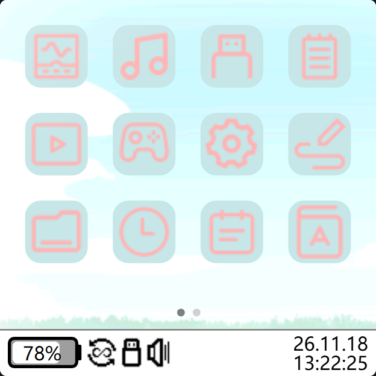
  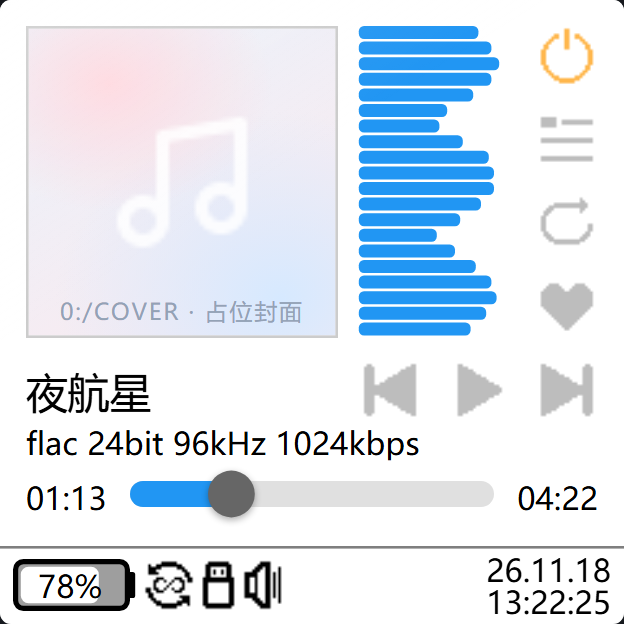
</p>

## 功能

| 分类 | 内容 |
| --- | --- |
| 音乐 | WAV / MP3 / FLAC / AAC / APE / AIFF / OGG；实时频谱、LRC 歌词、专辑封面、进度拖拽、顺序/随机/单曲循环 |
| 媒体 | MJPEG / AVI / RAW 视频（240×240 全屏）；BMP / PNG / GIF 动图 / JPG 图片浏览 |
| 游戏 | NES 模拟器（6502 + PPU + APU，110+ mapper，支持 NSF） |
| 工具 | 记事本、画板、文件管理（TF + U 盘双盘符）、时钟/日历（含农历）、背单词、计算器、抽签 |
| 系统 | 内存监控（TLSF 双池曲线与碎片率）、CPU 占用、按键测试、串口终端、Letter Shell、字库更新、日志控制、电脑副屏 |
| USB Device | CDC 日志/调试、虚拟 U 盘、UAC1/UAC2 解码耳放、电脑副屏、HID 手柄/键盘/鼠标 |
| USB Host | 串口助手、U 盘读取、手柄、HID 外设 |

Type-C 主从角色由 ADC 采样 CC1/CC2 电压自动判定，无需手动切换。

## 界面

<p align="center">
  
  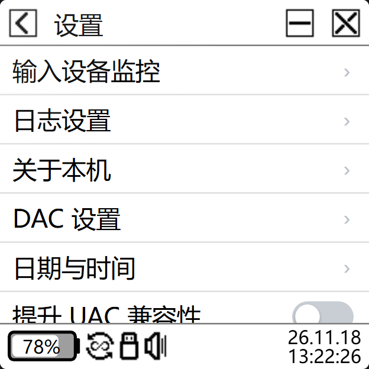
  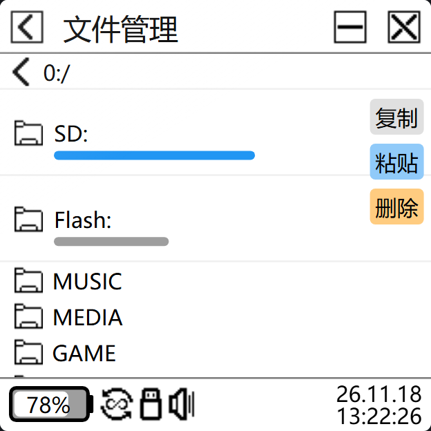
  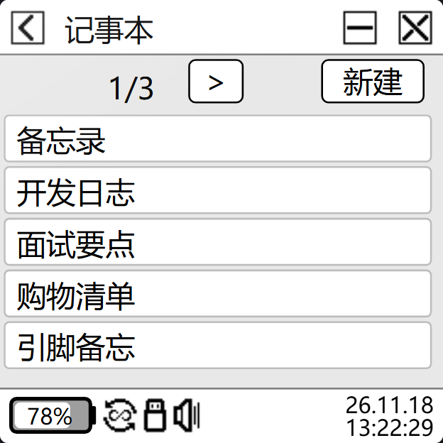
</p>
<p align="center">
  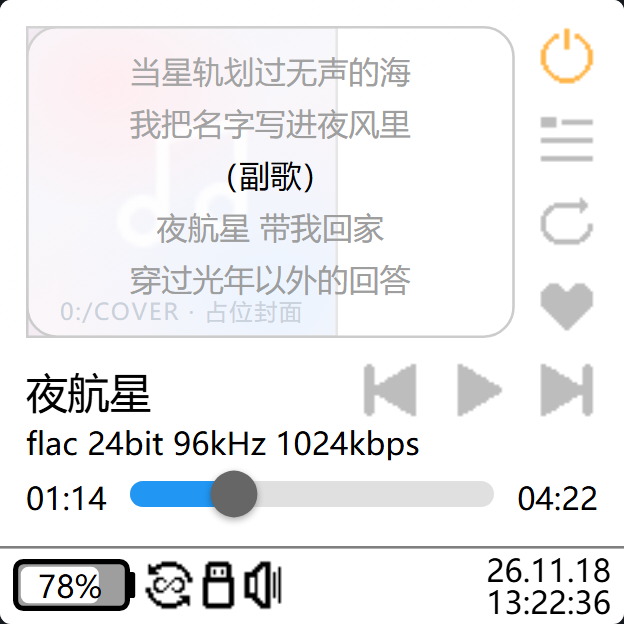
  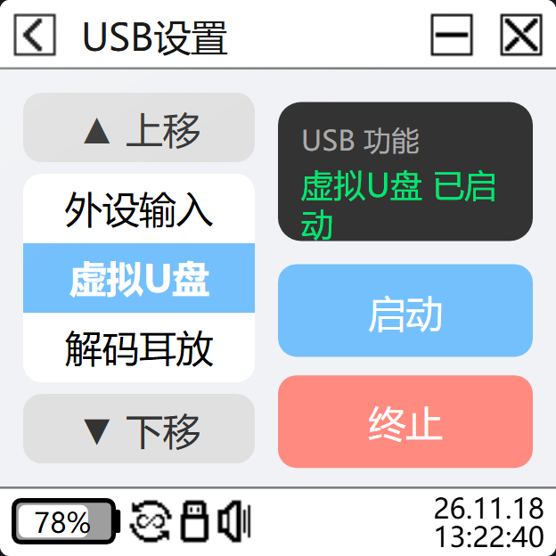
  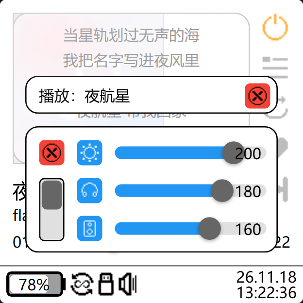
  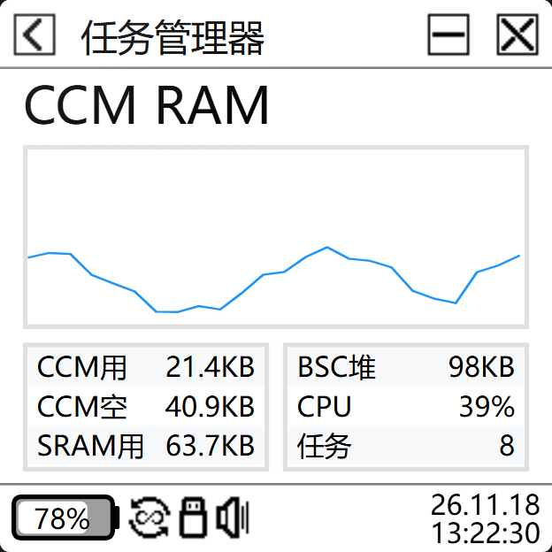
</p>
<p align="center">
  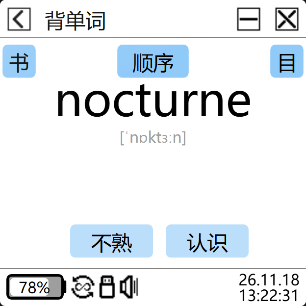
  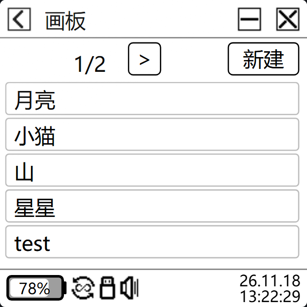
  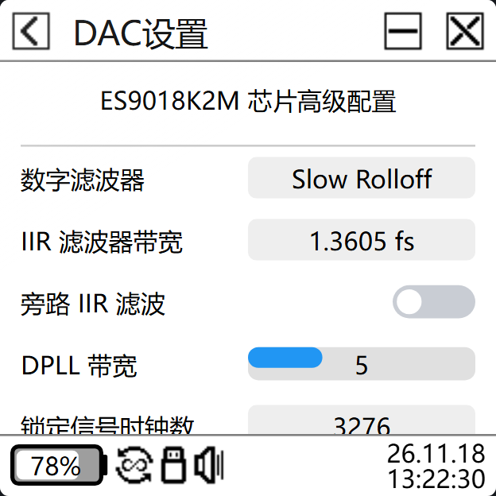
  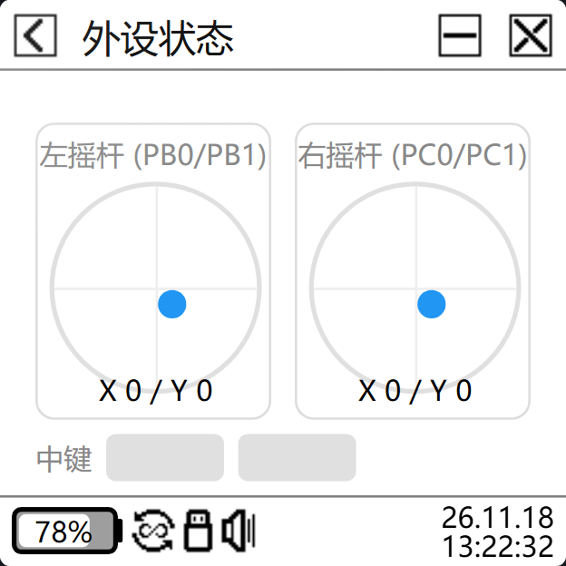
</p>

文中截图（顶部机身图 + 桌面 + 音乐，以及上方 12 张）全部由 [ui-sim](ui-sim/README.md)
按固件布局逐像素复刻后截取，界面数值（坐标、尺寸、字号）与 `ware/GUI/GUI_Unit/*.c` 一一对应。

## 硬件

| 项 | 参数 |
| --- | --- |
| 主控 | STM32F405RGT6，Cortex-M4F @ 168 MHz，1 MB Flash / 128 KB SRAM / 64 KB CCM |
| 屏幕 | 1.54″ IPS 240×240（ST77xx 兼容初始化序列），SPI1 + DMA2_Stream5，TIM8_CH1 PWM 背光 |
| 存储 | W25Q128 16 MB（SPI3 + DMA1）；TF 卡（SDIO 4-bit + DMA2_Stream3） |
| 音频 | ES9018K2M（软件 I2C 配置）+ MAX98357A 功放；I2S2 + DMA1_Stream4，耳机/喇叭硬件切换 |
| 输入 | 双摇杆（ADC1 四通道 + 两枚中键）、顶部唤醒键（兼 UF2 进入键） |
| 电源 | Type-C 取电与对外供电、充电检测、电池 ADC 采样、Standby 唤醒 |

完整引脚 / DMA / 中断分配见 **[docs/HARDWARE_RESOURCE_MAP.md](docs/HARDWARE_RESOURCE_MAP.md)**。

## 架构

```
任务层   10 个 FreeRTOS 任务 + Task_Manager（环形请求队列）
页面层   GUI_Page x 30（page_manager：注册表 + 历史栈）· GUI_Unit x 33
应用层   Music(7 格式) · Media(图片/视频) · NES · Text · USB(13 功能) · Tool
框架层   LVGL 8.2 · FatFS R0.16 · FlashDB 2.1.1 · CherryUSB 1.6 · TLSF · Letter Shell
系统层   FreeRTOS 11.1（heap 重定向到 TLSF）
BSP 层   LCD · I2S · SDIO · W25Q128 · ADC · RTC · ES9018 · 按键 · 电源 · 看门狗
基础层   CMSIS + STM32F4xx 标准库 + 启动汇编
         Bootloader（独立工程，Flash 前 64 KB）
```

**存储器布局**

| 区域 | 起始地址 | 大小 | 用途 |
| --- | --- | --- | --- |
| Bootloader | `0x08000000` | 64 KB | UF2 引导、镜像 CRC 校验 |
| APP | `0x08010000` | 960 KB | 主固件，`SCB->VTOR` 重定向 |
| SRAM | `0x20000000` | 128 KB | 全局变量、任务栈、TLSF BSC 池 97 KB（**DMA 可用**） |
| CCM RAM | `0x10000000` | 64 KB | 2 × TLSF 控制块 + CCM 池约 62 KB（**DMA 不可访问**） |
| W25Q128 | — | 16 MB | 0–4 MB KVDB / 4–8 MB TSDB / 8–15 MB 字库 |

> DMA 缓冲区必须走 `malloc_bsc()`：CCM 不挂在 DMA 总线矩阵上，只能放 CPU 侧对象。

**任务**

| 任务 | 优先级 | 栈 | 职责 |
| --- | --- | --- | --- |
| `Font_Task` / `FileOp_Task` | 1 | 512 | 字库烧写 / 后台文件复制删除 |
| `Lvgl_Task` / `Media_Task` / `Game_Task` | 2 | 512 | UI 刷新（20 ms） / 媒体解码 / NES |
| `Basic_Task` / `Music_Task` | 3 | 512 / 2048 | 20 ms 轮询外设与喂狗 / 播放状态机 |
| `USB_Task` | 4 | 512 | USB 功能状态机 |
| `Task_Manager` / `Start_Task` | 7 / 8 | 512 | 任务生命周期管理 / 启动链跑完自删 |

抢占优先级 **5–15** 才能调用 `FromISR` API（对应 `configMAX_SYSCALL_INTERRUPT_PRIORITY`），0–4 严禁。

**启动链**

```
Bootloader：校验升级标记 -> 按住唤醒键则进 UF2；否则三重向量校验 + 整镜像 CRC -> 跳 0x08010000
APP：VTOR 重定向 -> NVIC/SysTick -> TLSF -> 按键/引脚/RNG/ADC -> RTC -> W25Q128
     -> KVDB（加载配置）-> TSDB -> 字库 -> 上报上次复位现场 -> Task_Manager
     -> 投递 6 个建任务请求 -> Start_Task 自删
```

## 编译与烧录

**环境**：Keil MDK 5 + Arm Compiler 5（AC5）+ Keil.STM32F4xx_DFP；Python 3（仅 UF2 打包）；ST-Link / DAP-Link。

```
打开 Brahman.uvprojx -> Build Target (F7)
输出：build\Keil\Brahman.axf
```

> Keil 默认不生成 HEX。需要时在 Options for Target -> Output 勾选 **Create HEX File**，产物为 `build\Keil\Brahman.hex`。

**首次烧录**必须先烧 Bootloader（`bootloader/bootloader.uvprojx` -> `0x08000000`），否则 APP 没有跳转入口。

**UF2 拖拽升级**：上电时按住顶部唤醒键（或固件损坏）进入 UF2 模式 -> 电脑出现卷标 `CHERRYUF2` 的盘 -> 拖入 `.uf2` -> 自动写入校验后重启。

```bash
cd bin2uf2
python uf2conv.py                      # 极简模式：取 ../Objects/project.bin，输出带时间戳 .uf2
python uf2conv.py ../build/Keil/Brahman.hex -c -b 0x08010000 -f 0x57755a57 -o Brahman.uf2
```

Windows 可直接双击 `bin2uf2/run_this_to_make_uf2.bat`。基址与 familyID 必须匹配：`-b 0x08010000`、`-f 0x57755a57`，否则 Bootloader 静默丢弃所有块。

升级的三道保险：升级标记存 RTC 备份寄存器（掉电停 UF2 不变砖）、三重向量校验（栈顶在 SRAM / 复位向量在 APP 区 / bit0=1）、整镜像 CRC（识别半截固件）。

## SD 卡目录

```
0:/                  TF 卡根目录（FatFs 盘符 0）
├── MUSIC/           音乐（wav/mp3/flac/aac/ape/aif/aiff/ogg）
├── COVER/           专辑封面（与曲目同名 .bmp，缺省 default.bmp）
├── MEDIA/           图片与视频（bmp/png/gif/jpg/mjpeg/avi/raw）
├── GAME/            NES ROM（.nes）与 NSF
├── WORDLIST/        词书（纯文本）
├── FONT/            字库（UNIGBK.bin / Font8/12/16/24.bin）
├── Note/  Canvas/   笔记与画作（固件自动创建）
```

> 字库需首次手动更新一次：把 `FONT/` 下 5 个 `.bin` 放进卡里，在「设置 -> 字库更新」执行，写入 W25Q128 的 8–15 MB 区域。

## 关键设计

**TLSF 双内存池** — `configTOTAL_HEAP_SIZE = 0`，`pvPortMalloc` 重定向到 TLSF：SRAM 池 97 KB（`malloc_bsc`，DMA 可达，用于显存/解码缓冲/USB 帧池）+ CCM 池约 62 KB（`malloc_ccm`，LVGL 对象与内核对象）。两池各带互斥锁，`tlsf_monitor_bsc/ccm()` 供内存监控页绘制曲线与碎片率。

**任务管理器** — 业务任务不直接 `vTaskSuspend`，而是向环形队列投递 `Taskmanager_Ctrl(task, action, fromISR)`，由 `Task_Manager` 串行执行，新请求覆盖未处理旧请求。`Taskmanager_Wait_Suspended()` 用于在释放任务正在使用的资源（如显存）前确认它已真正挂起。

**页面管理器** — `page_registry[PAGE_MAX_ID]` 静态数组实现 O(1) 切换；只有 UNINIT / ACTIVE 两态，离开必调 `exit()` 释放对象；历史栈深度 6；`can_exit()` 可拦截离页（如未保存确认）；状态与历史栈的读改写在临界区内完成。

**音频链路** — TF 卡 -> FatFs -> 格式解码器 -> PCM -> I2S2 DMA 双缓冲 -> ES9018K2M -> 耳机 / MAX98357A。seek 按格式分四类：字节比例（WAV/AIFF）、比例 + 重同步（MP3/AAC/FLAC）、帧索引（APE）、解码器原生（OGG）。

**持久化与故障现场** — W25Q128 上 0–4 MB 为 KVDB（亮度、音量、输出通道、DAC 配置、UAC 开关、词书进度等）、4–8 MB 为 TSDB（运行日志）。崩溃时把 PC/LR/PSR/CFSR/HFSR 与原因码写进 RTC 备份寄存器，复位后由 `Fault_Log_Pending()` 记一条 `[FAULT]` 日志并清魔数；启动阶段外设失败记 `[INIT] failed at step N`（1=RTC 2=FLASH 3=KVDB 4=TSDB）。看门狗由 `Basic_Task` 喂，FlashDB flush/GC 前显式 `IWDG_FEED_SAFE()`。

**健壮性约束** — SD 读写校验 DMA 完成状态与返回值、超时按失败处理；ES9018 配置用快照语义；LCD DMA 提交前等上一笔结束；拔卡与在途传输通过外部锁配对；解码缓冲先按目标宽高裁剪再拷贝；USB 关闭时先断端点中断、清标志、等在途回调走完再释放。

## 目录结构

```
Brahman/
├── main/         入口、全局变量、中断向量
├── ware/
│   ├── BSP/      板级驱动：LCD/I2S/SDIO/W25Q128/ADC/RTC/ES9018/按键/电源/看门狗
│   ├── Tasks/    10 个任务 + task_manager.c
│   ├── GUI/      GUI_Page(30) · GUI_Unit(33) · GUI_Icons
│   ├── APP/      Music · Media · NES · Text · USB
│   ├── tool/     字库更新、KVDB 封装、TSDB 日志、频谱 DSP、拼音、农历、CPU 统计
│   └── lib/      LVGL 8.2 / FreeRTOS 11.1 / FatFS R0.16 / FlashDB 2.1.1 /
│                 CherryUSB 1.6 / TLSF / Letter Shell / PNGdec / Tjpgd / AnimatedGIF
├── bootloader/   独立 Bootloader 工程（UF2 + CRC + 掉电标记）
├── bin2uf2/      UF2 转换脚本
├── docs/architecture/  分层架构交互图（HTML）
└── ui-sim/       前端 UI 模拟器（1:1 复刻固件界面，无需真机）
```

## 相关文档

| 文档 | 内容 |
| --- | --- |
| [docs/HARDWARE_RESOURCE_MAP.md](docs/HARDWARE_RESOURCE_MAP.md) | 51 个可用 I/O 中的 47 个分配、6 条 DMA 流、中断优先级全表 |
| [docs/architecture/brahman-architecture.html](docs/architecture/brahman-architecture.html) | 可交互分层架构图，浏览器直接打开 |
| [ui-sim/README.md](ui-sim/README.md) | UI 模拟器用法：`cd ui-sim && python -m http.server 8931` |

